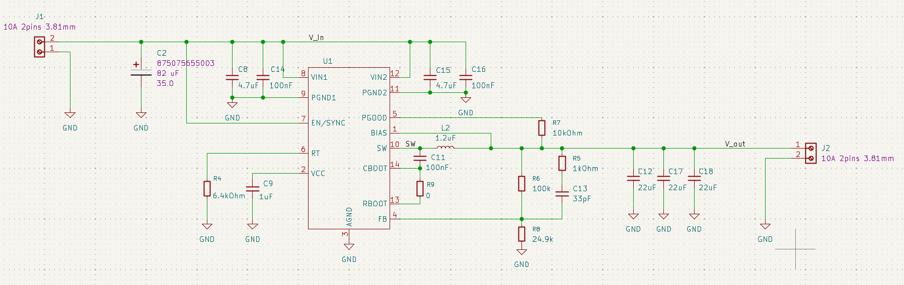
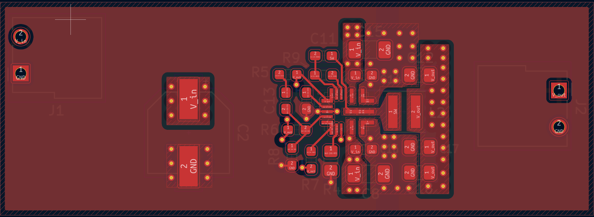
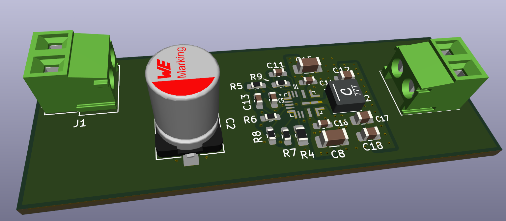

# Convertisseur Buck – PCB prototype (LMQ61460-Q1)

Conception d'un prototype de PCB pour un convertisseur abaisseur (buck) synchrone basé sur le **LMQ61460-Q1** de Texas Instruments, de la création du symbole KiCad jusqu'au choix des composants pour la fabrication.

> **Statut :** conception terminée, commande des composants en cours. *(à mettre à jour : fabrication / tests)*

---

## Sommaire

1. [Cahier des charges](#1-cahier-des-charges)
2. [Outils](#2-outils)
3. [Schéma électrique](#3-schéma-électrique)
4. [Dimensionnement](#4-dimensionnement)
5. [Liste des composants](#5-liste-des-composants)
6. [Routage du PCB](#6-routage-du-pcb)
7. [Références](#7-références)

---

## 1. Cahier des charges

| Paramètre | Valeur |
|---|---|
| Circuit intégré | LMQ61460-Q1 (buck synchrone, courant de sortie max 6 A) |
| Tension d'entrée nominale | 24 V |
| Tension d'entrée max | 30 V à 36 V selon le cas étudié |
| Tension de sortie | 5 V (cas d'étude), ajustable via le diviseur de tension du FB |
| Courant de sortie max | 6 A |
| Fréquence de commutation | 1,86 MHz |
| Ondulation de courant dans l'inductance | K = 25 % |
| Commande | Mode courant, rétroaction externe (FB) |

---

## 2. Outils

- **KiCad** : schématique, création du symbole, routage
- **JLCPCB** : fabrication du PCB et assemblage / composants CMS
- **LCSC, Würth Elektronik (WE), Coilcraft** : composants commandés séparément
- Datasheet du LMQ61460-Q1, et du condensateur de 82 µF

---

## 3. Schéma électrique

Étapes suivies dans KiCad :

1. Création du symbole du LMQ61460-Q1
2. Placement des composants dans l'éditeur de schématique : symbole, connecteurs d'entrée/sortie, composants passifs
3. Câblage du circuit intégré avec les connecteurs et les passifs selon le circuit d'application de la datasheet

---

## 4. Dimensionnement

### 4.1 Fréquence de commutation maximale

La fréquence de commutation fixe les durées $t_{on}$ et $t_{off}$. Il faut vérifier que $t_{on} > t_{on,min}$ et $t_{off} > t_{off,min}$ : sinon, la fréquence est trop élevée.

$$f_{sw} \leq \frac{V_{out}}{V_{in,max} \cdot t_{on,min}}$$

Avec $t_{on,min} = 70\ \text{ns}$ :

| $V_{out}$ | $V_{in,max}$ | $f_{sw,max}$ |
|---|---|---|
| 5 V | 30 V | 2381 kHz |
| 6 V | 36 V | 2381 kHz |

Conséquence : à $V_{in,max}$ = 36 V et $f_{sw}$ = 2,1 MHz, la plus petite tension de sortie réalisable en régulation est d'environ **5,3 V**.

### 4.2 Tension de sortie (diviseur de rétroaction)

Le convertisseur régule la tension de sortie en maintenant la tension de la broche FB égale à la référence interne $V_{ref}$ (1 V). Un diviseur $R_{FBT}$ / $R_{FBB}$ ramène donc $V_{out}$ à 1 V :

$$V_{out} = V_{ref}\left(1 + \frac{R_{FBT}}{R_{FBB}}\right)$$

| $V_{out}$ | $R_{FBT}$ | $R_{FBB}$ |
|---|---|---|
| 5 V | 100 kΩ | 24,9 kΩ |
| 12 V | 100 kΩ | 9,09 kΩ |

Pour changer $V_{out}$, on modifie uniquement $R_{FBB}$.

### 4.3 Inductance

Les paramètres de choix sont la valeur de l'inductance et l'ondulation de courant crête-à-crête (20 % à 40 % de $I_{out}$). Pour une tension d'entrée variable, **K = 25 %** est retenu.

$$L = \frac{V_{in} - V_{out}}{f_{sw} \cdot K \cdot I_{out,max}} \cdot \frac{V_{out}}{V_{in}}$$

Application numérique ($V_{out}$ = 5 V, $V_{in}$ = 24 V, $f_{sw}$ = 1.86 MHz, K = 0,3, $I_{out,max}$ = 6 A) : **L ≈ 1,18 µH** → valeur normalisée retenue : **1,2 µH**.

Remarques :
- $I_{out,max}$ est le courant maximal que peut délivrer le circuit (6 A), et non le courant maximal d'une charge particulière.
- Le courant de saturation doit vérifier $I_{sat} > I_{L,HS}$ (courant maximal admissible côté high-side).
- Pour conserver un fonctionnement correct de la commande en mode courant, l'ondulation minimale doit rester supérieure à 10 %, ce qui donne $L_{max}$ = 3,14 µH.

### 4.4 Condensateurs de sortie

La datasheet propose soit uniquement des céramiques, soit un mélange céramique + électrolytique.

| | Céramique seule | Céramique + électrolytique |
|---|---|---|
| Avantages | ESR faible (faible ondulation, pertes négligeables), longue durée de vie | Bon comportement aux variations brusques de courant, grande réserve d'énergie, ESR élevée (meilleur amortissement des boucles de contrôle) |
| Inconvénients | Perte de capacité sous tension (30 à 50 % de la valeur à 12 V : prendre du 25 V pour une sortie 12 V), faible capacité volumique (mise en parallèle nécessaire) | Durée de vie courte, encombrement |

**Choix : céramiques uniquement.** D'après la Table 8-3 de la datasheet : **3 × 22 µF** en sortie, plus un condensateur **Cff de 33 pF** (avec **Rff = 1 kΩ**) pour améliorer la réponse transitoire à 2,1 MHz.

### 4.5 Condensateurs d'entrée

Le boîtier possède deux côtés d'alimentation. Selon la datasheet :
- **100 nF** céramique obligatoire de chaque côté
- plus soit 1 × 10 µF, soit **4,7 µF de chaque côté** (option retenue)

Un condensateur électrolytique en entrée (82 µF) est recommandé, voire nécessaire si les pistes d'alimentation sont longues : son ESR amortit les oscillations (ringing) causées par les câbles d'alimentation.

### 4.6 VCC, CBOOT, RBOOT et EN/SYNC

| Élément | Rôle | Valeur |
|---|---|---|
| VCC | Alimentation des circuits de commande | 1 µF, 16 V, céramique |
| CBOOT | Réserve d'énergie pour le driver du MOSFET high-side | 100 nF, min 10 V, céramique |
| RBOOT | Réduit les EMI mais diminue le rendement | 0 Ω |
| EN/SYNC | Démarrage / arrêt, réglable par diviseur de tension | voir ci-dessous |

Seuils de EN/SYNC (à confirmer avec la datasheet avant publication) :

| $V_{EN/SYNC}$ | État |
|---|---|
| < 0,4 V | Circuit en arrêt (shutdown) |
| 0,4 V à 1,268 V | VCC actif, noeud SW inactif |
| > seuil haut | Commutation normale |

### 4.7 Réglage de la fréquence (résistance RT)

$$R_{RT}\,[\text{k}\Omega] = \left(\frac{1}{f_{sw}\,[\text{kHz}]} - 3{,}3 \cdot 10^{-5}\right) \cdot 1{,}346 \cdot 10^{4}$$

Pour $f_{sw}$ = 2100 kHz, on obtient **R_RT ≈ 6 kΩ**. Valeur normalisée utilisée : 6,8 kΩ (Würth), soit une fréquence réelle d'environ 1,86 MHz.

---

## 5. Liste des composants

| Rôle | Valeur | Boîtier  | Réf. commande | Fabricant |
|---|---|---|---|---|
| Convertisseur Buck | - | VQFN-14-HR | C1855832 | LCSC |
| Condensateurs d'entrée (HF) | 2 × 100 nF | 0603 | 885012206095 | Würth |
| Condensateurs d'entrée | 2 × 4,7 µF | 1206 | 885012208094 | Würth |
| Condensateur d'entrée (électrolytique) | 82 µF | [datasheet](https://www.we-online.com/components/products/datasheet/875075655003.pdf) | 875075655003 | Würth |
| VCC | 1 µF | 0603 | 885012206052 | Würth |
| RT | 6 kΩ / 6,8 kΩ | 0805 | 560112120031 | Würth |
| PGOOD (pull-up) | 10 kΩ | 0603 | 560112116005 | Würth |
| Inductance | 1,2 µH | 1008 | XAL4020-122MEC | Coilcraft |
| CBOOT | 100 nF | 0603 | 885012206046 | Würth |
| FB haut (RFBT) | 100 kΩ | 0603 | 560112116004 | Würth |
| FB bas (RFBB) | 24,9 kΩ | 0603 | 560112116140 | Würth |
| Cff | 33 pF | 0603 | 885012006020 | Würth |
| Rff | 1 kΩ | 0603 | 560112116014 | Würth |
| Condensateurs de sortie | 3 × 22 µF | 0805 | 885012107011 | Würth |
| Connecteurs d'entrée/sortie | 2 × borniers à vis | 3.81 mm | 691214300002 | Würth |

---

## 6. Routage du PCB

Pour cette partie, j'ai essayé de respecter les consignes du Layout présentées sur la datasheet du convertisseur.

---

## 7. Références

- Datasheet LMQ61460-Q1, [Texas Instruments](https://www.ti.com/lit/ds/symlink/lm61460-q1.pdf?ts=1794761123150&ref_url=https%253A%252F%252Fwww.ti.com%252Fproduct%252FLM61460-Q1%253FkeyMatch%253DLM61460-Q1%2526tisearch%253Duniversal_search%2526usecase%253DGPN-ALT)
- Condensateur d'entrée (82 µF), [Würth](https://www.we-online.com/components/products/datasheet/875075655003.pdf)

---

**Auteur :** Houssam BEKRI, élève ingénieur ENSEA
